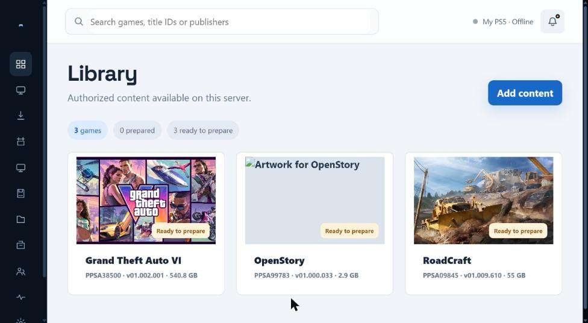
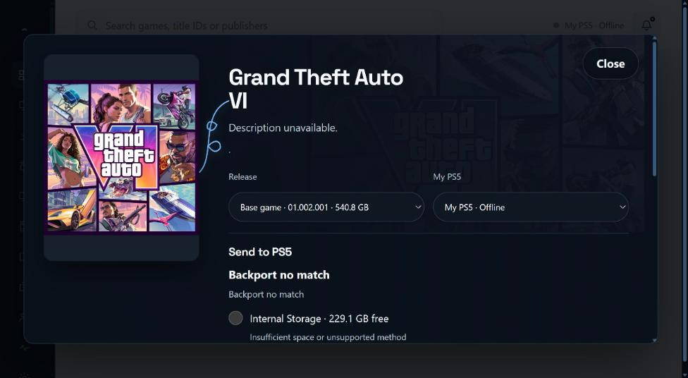
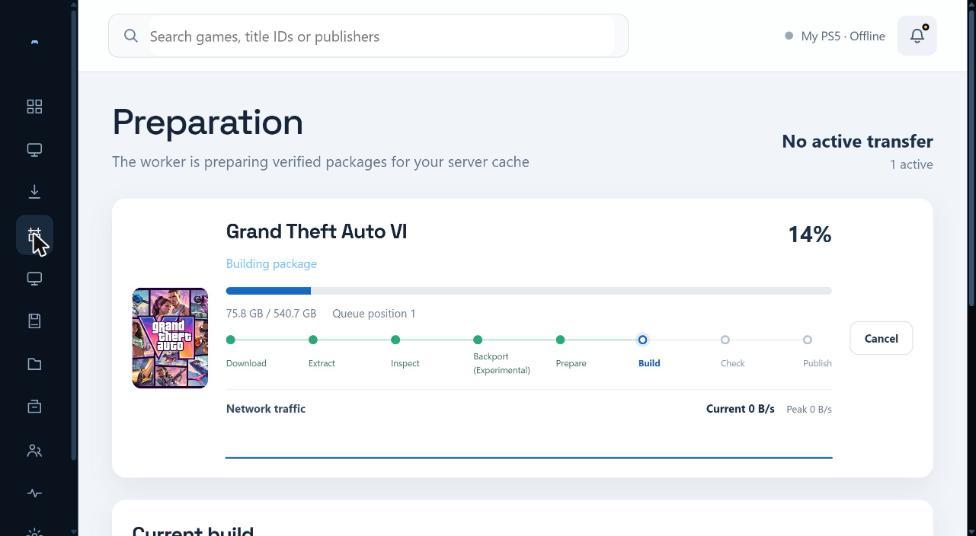
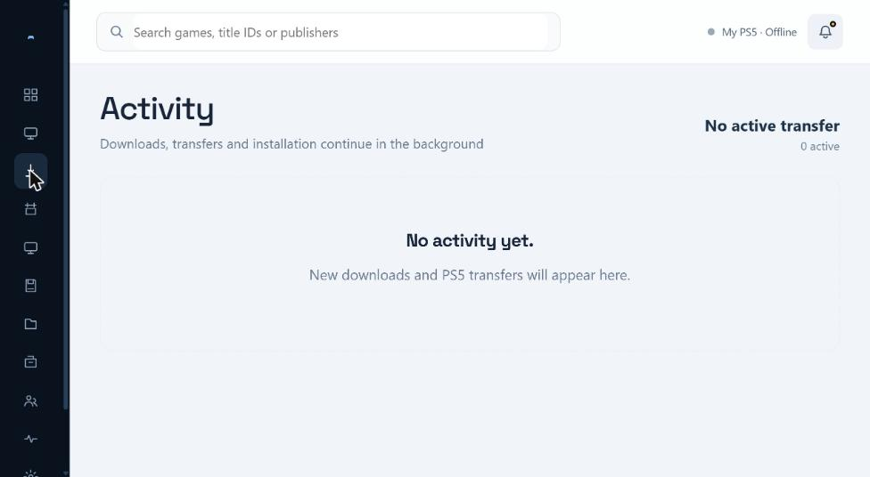

<div align="center">

<a href="https://www.buymeacoffee.com/rdiol12" target="_blank"></a>

*If my work helped you, a coffee keeps the next project coming.*

</div>

---

# PS5Library

A self-hosted, visual homebrew/game library for authorized content, with a native PS5 storefront, durable preparation/download jobs, multiple private user accounts and registered consoles.

**Engineering preview.** The server, real package/image worker and native PS5 ELF build locally. The generated packages, home-entry installer, notifications and mounting need physical PS5 validation. The user's first target is firmware **4.50**; the design supports capability negotiation across jailbreakable firmware, not a blanket promise that every feature works everywhere. See [STATUS.md](docs/STATUS.md) for what is verified and what remains.

## Screenshots

<table>
<tr>
<td align="center" width="50%"><br><sub><b>Library</b></sub></td>
<td align="center" width="50%"><br><sub><b>Game detail</b></sub></td>
</tr>
<tr>
<td align="center" width="50%"><br><sub><b>Server-driven build</b></sub></td>
<td align="center" width="50%"><br><sub><b>Activity &amp; jobs</b></sub></td>
</tr>
</table>

<p align="center"><em>The self-hosted web dashboard.</em></p>

## Start the self-hosted server

Prerequisites: a current Docker Engine or Docker Desktop with Compose v2, Git, and a supported Node.js version. The Linux container includes the .NET worker and FFmpeg. See [SERVER.md](SERVER.md) for Linux, Windows, storage, backport, security, update, and recovery instructions.

```powershell
npm ci
npm run setup
npm run upstream
npm run docker:configure
npm run docker:up
```

Open **http://127.0.0.1:3150**. Create the first account using `BOOTSTRAP_TOKEN` from the local `.env` file and a password of at least 12 characters. Do not paste that secret into public messages. Later accounts require a one-use invitation created by an admin in Accounts. Owners can share games with server members; consoles, credentials, jobs and profile data stay private. A PS5 pairs once using its displayed code; its random device credential persists across launches.

The API binds to loopback by default. For friends/remote consoles, put it behind your HTTPS reverse proxy or private VPN, configure `PUBLIC_URL` and the appropriate bind address, and use a trusted certificate. Keep PostgreSQL/Redis and console payload-loader ports private. Native clients do not bypass certificate verification.

`PUBLIC_URL` is also the trusted browser origin. To open the same server at additional addresses, list their exact origins in `BROWSER_ORIGINS` and restart the server. For example, after setting a LAN `PUBLIC_URL`, use `BROWSER_ORIGINS=http://127.0.0.1:3150,http://localhost:3150` to keep PC access working. Include the scheme and port; omit paths and wildcards. An unconfigured browser address returns `ORIGIN_DENIED`.

The API, package worker, media transcoder, PostgreSQL and Redis run in Docker. Use `npm run docker:restart` to restart the API, `npm run docker:logs` for logs and `npm run docker:up` after code changes. Cache data persists through container replacement. Source repositories and the worker's dump view are read-only; the API's dump mount is writable only for explicit verified retirement. Rerun `npm run docker:configure` after changing host mount paths, then recreate the server container.

For host-side development only, install .NET 10, start just the `postgres redis` Compose services, and use `npm run build:worker`, `npm run build`, then `npm start`. Stop the Docker server before starting a host API on the same port.

Existing Windows deployments need the portable-source migration before their first Linux-container activation: back up the database/data/.env, stop all jobs and the host API, then run `node --env-file=.env --import tsx scripts/portable-sources.ts` for a dry run and add `--apply` to migrate. Do not rerun setup or replace persistent database volumes to upgrade.

## Add your content

For automatic local ingestion, set `DUMP_ROOT` in `.env` and restart the server. Stable prepared dumps are inspected, cataloged, illustrated from local artwork and queued for conversion. Root `backport`, `fakelib`, and `fakelib2` content is stored separately under `DATA_DIR/backports` and excluded from generated game artifacts. Inspection and conversion preserve the original. After the exact FPKG and required backport have been verified, an administrator may explicitly retire and delete that watched dump; the retained package and backport remain cataloged and usable. Build completion never deletes source dumps automatically because another profile or build method may still need them. See [SERVER.md](SERVER.md) for the supported folder layout and limitations.

Connectors support local folders, static manifests, private HTTP manifests and a GitHub release containing `ps5library.json`. Automatic source scanning can be configured every 5–1440 minutes. There is no automated commercial-game warez-site connector.

For local content, create `data/sources/<YOUR_USER_UUID>/<folder>/library.json`, then add a Local Folder source using that folder name. `/api/v1/me` returns your account ID. The browser Source form and [shared schema](shared/schemas/index.ts) define the complete format.

```json
{
  "schemaVersion": 1,
  "releases": [{
    "key": "my-homebrew-1.0",
    "game": {
      "title": "My Homebrew",
      "titleId": "BREW05002",
      "contentId": "IV0000-BREW05002_00-MYHOMEBREW000000",
      "description": "My own homebrew application",
      "genres": ["Homebrew"],
      "artwork": { "cover": "cover.png", "hero": "hero.jpg" }
    },
    "version": "01.00",
    "format": "elf",
    "size": 65536,
    "sha256": "REPLACE_WITH_THE_ACTUAL_64_CHARACTER_SHA256",
    "location": "my-homebrew.elf",
    "minimumFirmware": null
  }]
}
```

Replace sample size/hash with actual values. Unknown firmware stays unknown. For prepared game folders, use format `folder`, a relative directory location and the hash/size from `dotnet worker/bin/Release/net10.0/PS5Library.Worker.dll hash-tree <folder>`. The folder must contain `eboot.bin` and `sce_sys/param.json`. Source files are never modified. Private repository tokens are configured as `REPOSITORY_TOKEN_*` environment variables; exact private origins must be allowlisted.

After building our PS5 ELF, `npm run demo -- <YOUR_USER_UUID>` creates a local source containing PS5Library's own compiled payload and original icon. It does not install itself or claim untested firmware compatibility.

## Downloads, preparation and PC cache

Game music is imported from a dump's `sce_sys/snd0.at9` (or supported WAV/OGG/MP3/FLAC/M4A menu audio), cached on the server, and played when a cover stays highlighted. **Game music** has its own native Settings toggle; trailers take over after five seconds. See [music sources and limits](docs/PS5_MUSIC.md). Audible HDMI output and PS-button Home/background behavior still need physical validation; see [native UI investigation](docs/PS5_SYSTEM_INTEGRATION.md).

Select a release, an owned PS5, supported storage and method. `POST /api/v1/installations` persists the workflow. The server downloads/extracts/builds when supported, verifies the output, reuses an exact verified cache hit, waits for an offline console, then queues transfer. Jobs continue when a client closes or the server restarts.

Folder and safe-ZIP inputs can build real `.pkg` FPKG/debug images with LibProsperoPKG or UFS2 `.ffpkg` images for ShadowMountPlus. These are separate adapters. Unsupported/encrypted/corrupt/mismatched inputs fail explicitly. Conversion exposes actual stages, not fabricated byte percentages.

Prepared packages remain on the PC. The **Server cache** page lists them and can delete a selected copy when no active transfer uses it. Deletion preserves the source and console copy. Native/iPhone normal flows use the installation coordinator; browser advanced controls also expose standalone download, build and transfer.

## Build the PS5 application

```powershell
docker build -f docker/ps5-build.Dockerfile -t ps5library-build:0.43 .
docker run --rm -v "${PWD}:/workspace" ps5library-build:0.43 cmake -S ps5 -B ps5/build/ps5 -DCMAKE_BUILD_TYPE=Release -DCMAKE_TOOLCHAIN_FILE=/opt/ps5-payload-sdk/toolchain/prospero.cmake
docker run --rm -v "${PWD}:/workspace" ps5library-build:0.43 cmake --build ps5/build/ps5 -j 8
```

Outputs:

- `ps5/build/ps5/ps5library.elf` — native SDL storefront with embedded foreground agent.
- `ps5/build/ps5/ps5library-agent.elf` — separate agent payload, with runtime persistence still unverified.
- `ps5/build/ps5/ps5library-install.elf` — experimental home-entry installer with the original PS5Library icon, frontend ELF, font and CA bundle.

The installer requires a running compatible websrv and an already configured Homebrew Launcher bootstrap. It registers only our owned `BREW05001` title folder through an available exact-title API; it does not automatically invoke broad install-all or create system bootstrap files. It cannot currently register the shortcut through the unverified 12+ path. The storefront can still be deployed through a supported homebrew launcher when shortcut registration is unavailable.

On first launch, **Connect your library** opens automatically. Enter your server's HTTPS address, choose **Save & connect**, then claim the displayed pairing code from your signed-in account. **Settings → Server connection** reopens this flow. The frontend ELF includes its initial font, font license and trusted CA bundle, extracting missing files beside its configuration. Existing custom certificates/fonts are preserved. First-run rendering and input still need PS5 hardware validation.

HTTPS is the default. Plain HTTP requires explicitly enabling **Unencrypted HTTP** and should only be used on a trusted local network. Enter the server origin without an API path, query or embedded password. Changing to another server requires **Switch & pair again**; it stops the old connection, generates a new device identity and preserves existing local files. The old credential is never sent to the new server. If a separate agent is running, stop it before changing settings. One previous configuration/device backup is kept locally in `previous-server.json`; protect it like a password.

Advanced settings remain in `/data/ps5library/config.json`, using [config.example.json](ps5/config.example.json): display name, runtime and actual storage. Known kstuff/kstuff-lite processes fill an otherwise unknown runtime; unidentified runtimes keep compatibility unknown. ShadowMount support is negotiated through its local API v1 using the port in `/data/shadowmount/config.ini`. Its listener stays local. Notifications remain an explicit setting pending hardware verification. Preserve `device-state.json`; it contains the paired credential and is bound to the selected server. Inventory receipts are bound to both server and console; older unbound receipts require explicit re-import.

Selecting the home entry uses the existing loader to start the native app. That loader may close the running game. Reboot requires re-enabling the jailbreak/runtime/loader; a persistent icon does not create persistence for those services. [System integration](docs/PS5_SYSTEM_INTEGRATION.md) records the source evidence, physical 4.50 launch/registration observations and recovery details. Home-icon presentation, native background behavior and the latest trailer build still need hardware validation.

## Native design preview and checks

```powershell
docker run --rm -v "${PWD}:/workspace" ps5library-build:0.43 cmake -S ps5 -B ps5/build/host -DCMAKE_BUILD_TYPE=Release -DCMAKE_C_COMPILER=clang-18 -DCMAKE_CXX_COMPILER=clang++-18
docker run --rm -v "${PWD}:/workspace" ps5library-build:0.43 cmake --build ps5/build/host -j 8
docker run --rm -v "${PWD}:/workspace" ps5library-build:0.43 ctest --test-dir ps5/build/host --output-on-failure
node scripts/preview.mjs
docker run --rm -e SDL_VIDEODRIVER=dummy -v "${PWD}:/workspace" ps5library-build:0.43 ps5/build/host/ps5library data/reference/config.json --preview --frames=120 --capture=data/reference/discover.bmp
npm test
npm run test:worker
npm run test:integration
npm run test:native
```

Preview requires the user-supplied desktop `storefront.png`; preview assets stay local/ignored. It renders actual widgets, not a flattened screenshot. `--screen=Downloads`, `--screen=Game`, `--screen=My Library`, `--screen=My PS5`, `--size=1280x720` and `--script=right,down,select,back` support further inspection. Mutation is disabled in preview. Production mode obtains real API data.

Integration checks create/drop isolated PostgreSQL schemas and use generated/project-owned content. Native checks require the Docker build image and both native build outputs; they exercise controller server setup, pairing, verified ELF transfer, missing/corrupt content and confirmed server switching through the actual native application/agent running as an explicitly labeled host simulator.

## Companion apps and documentation

Two native companion apps connect to a server over a LAN/IP address or Tailscale, mirroring the dashboard's library, downloads and job tracking. The SwiftUI iOS app lives in `clients/ios/PS5LibraryCompanion.xcodeproj` — source can be developed here, but compiling, signing and simulator/device verification require macOS/Xcode (see [IOS.md](docs/IOS.md)). The Jetpack Compose Android app lives in `clients/android` (see [its README](clients/android/README.md)). Both are compiled as unsigned artifacts by the `client-release` GitHub Actions workflow.

Research and evidence: [RESEARCH](docs/RESEARCH.md), [ARCHITECTURE](docs/ARCHITECTURE.md), [FPKG](docs/FPKG.md), [SHADOWMOUNT](docs/SHADOWMOUNT.md), [BACKPORTING](docs/BACKPORTING.md), [SYSTEM INTEGRATION](docs/PS5_SYSTEM_INTEGRATION.md), [NOTIFICATIONS](docs/PS5_NOTIFICATIONS.md), [STORAGE](docs/PS5_STORAGE.md), [SECURITY](docs/SECURITY.md), [ARTWORK](docs/ARTWORK.md), [ENVIRONMENT](docs/ENVIRONMENT.md).

Third-party dependencies have their own licenses. The payload SDK, LibProsperoPKG and several researched projects carry GPL terms; UFS2Tool uses BSD-2-Clause. Keep corresponding notices/source obligations when distributing linked binaries. No public release is published by this workspace task.
