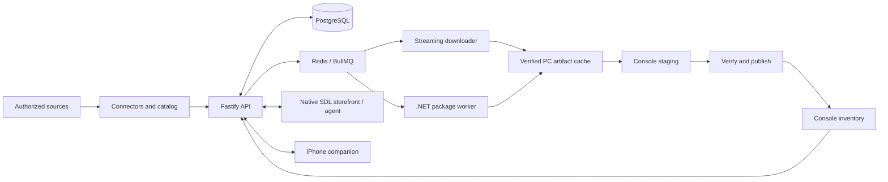

# Architecture

## Working structure

The API is the only client-facing service. PostgreSQL owns users, source records, releases, consoles, credentials, capabilities, storage, downloads/builds/transfers, installation requests, job events, compatibility/backport records, artwork pointers and weekly featured history. Redis schedules work; it is not the sole record of completion. Workers reconcile durable jobs after restart.

`Game` groups base/update/DLC releases. Server bookmarks and cached packages are separate from `ConsoleLibraryEntry`. A transfer is not ready until the authenticated console reports matching physical inventory and, where required, registration.

## How the server talks to a PS5

1. The PS5 initiates an HTTPS connection to the configured PS5Library server. It requests a short-lived pairing code; the signed-in owner claims that code from the companion. The console keeps its random device credential, bound to that server, across launches.
2. The active agent sends `/api/v1/device/heartbeat` with firmware, configured runtime information, capabilities, storage and managed inventory. Unknown runtime information stays unknown. The server derives presence from recent authenticated activity.
3. The PS5 storefront or iPhone submits an installation request. The PC downloads, checks and prepares the selected release, or reuses its matching verified cache. PostgreSQL preserves the request across restarts.
4. The PS5 asks `/api/v1/device/tasks` for its own queued transfers and pulls the supplied authenticated artifact URL. Range requests resume `.part` files. The server does not need an incoming connection to the PS5 or an exposed console loader port.
5. The agent reports measured bytes to `/api/v1/device/tasks/:id/progress`. It checks size/hash, publishes the completed file outside staging, and requests the supported runtime's registration. The server requires matching console inventory before READY.
6. Both clients read the resulting server state. Removing a managed file changes it to MISSING. Deleting a cached PC build leaves the console copy and source intact.

The PC must remain running for preparation and delivery. An offline PS5 can have content prepared for later, but cannot receive it until its agent reconnects. The current foreground app runs an agent thread; a separate agent ELF is also built. Background operation while playing, suspension and reboot autostart are not verified. Closing the iPhone never owns or cancels server work.

For friends outside the home network, publish the server through configured HTTPS or a private VPN. Each friend signs in separately and pairs their own PS5. Do not expose the PS5's unauthenticated homebrew loader as the PS5Library connection method.

## Ownership

Every catalog/source/job/console query is scoped to the authenticated account. An admin can issue one-use invitations but does not bypass library ownership checks. Friends receive independent accounts and can pair multiple consoles. Device credentials identify consoles; IP and MAC addresses are not authentication. HTTP user endpoints and device endpoints deliberately accept different credential types.

Current source catalogs are per owner. Sharing the server does not automatically expose an owner's private source credentials or library to friends. Fine-grained cross-account source grants are future work; accounts can configure their own authorized repository access now.

## Preparation and installation

`POST /api/v1/installations/plan` takes a source release and registered console. It computes supported methods, compatibility and storage estimates before building. `POST /installations` records the user's selection. A database coordinator obtains/reuses a verified artifact, waits for the console if offline, recalculates storage against the actual output, then queues the transfer. Repeated confirmation and coordinator restart cannot create duplicate transfers for the same active request.

Folder/ZIP preparation uses real FPKG or UFS builders. Other recognized ready artifacts can be downloaded/verified directly. Unsupported extraction/conversion stops explicitly. Cache keys contain the source hash, builder revision, installation method and pipeline version. Deleting a PC cache copy does not delete the source or the console's copy. Active transfers protect their artifacts against deletion.

Compatibility uses exact Title ID, Content ID, version, hashes, target firmware, runtime and method. Firmware eligibility alone does not mean launch-tested. Applying a backport remains disabled until the exact profile's patch/placement workflow can be verified.

## Frontend

The actual PS5 UI is C++17 + SDL2/SDL_image/SDL_ttf + libcurl + json-c. `frontend/design.hpp` owns layout tokens; `focus.hpp` owns controller navigation; `render.hpp` owns drawing/text caching; `artwork.hpp` owns two background image workers, conditional HTTP cache, decode cancellation and bounded GPU texture uploads. `main.cpp` composes the storefront screens from these primitives. Layout uses a logical 1920×1080 canvas scaled by SDL.

Production data is authenticated API data. `--preview` explicitly loads local design fixtures and refuses mutations. Network/decoding runs outside the render thread. A missing artwork texture draws a branded fallback. No commercial catalog is hard-coded into the production app.

The server exposes durable WebSocket job events with a resumable cursor. Current PS5 refresh uses asynchronous REST polling; native WebSocket consumption and push changes for storage/inventory are outstanding. The iPhone closes independently of server jobs.

### Local rendering measurements

On 2026-09-15, the Docker/Linux SDL dummy **software** renderer was exercised with the local reference fixture for 150 frames at 1920×1080. The Downloads screen initially measured a median 83.882 ms and p95 86.100 ms after rounded-shape scaling was corrected. Drawing only the glow border, instead of repainting the full card for each glow layer, reduced the same check to **29.616 ms median / 31.418 ms p95**, with 14,587,808 bytes of loaded artwork textures. Timing includes rendering/presentation; the preview's artificial inter-frame wait is excluded.

These are local comparison runs, not PS5 GPU measurements or a 60 FPS claim. Discover was also visually checked at 1280×720. Reproduce the Downloads check with the README's preview command plus `--screen=Downloads --frames=150`; the executable prints timings and writes `performance.json` beside its configuration. Hardware frame time, game coexistence and large-library stress checks remain required.

## Known ceilings

Global short locks serialize cache publication/quota and the installation coordinator. This is adequate for a small private server; partition by volume/account when throughput demands it. API catalog pagination, full large-library virtualization, large-archive streaming conversion, storage moves and automatic backport application remain required before calling this production-ready. See [STATUS.md](../STATUS.md).
