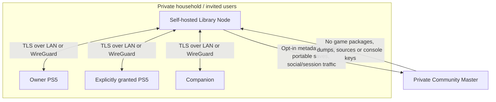
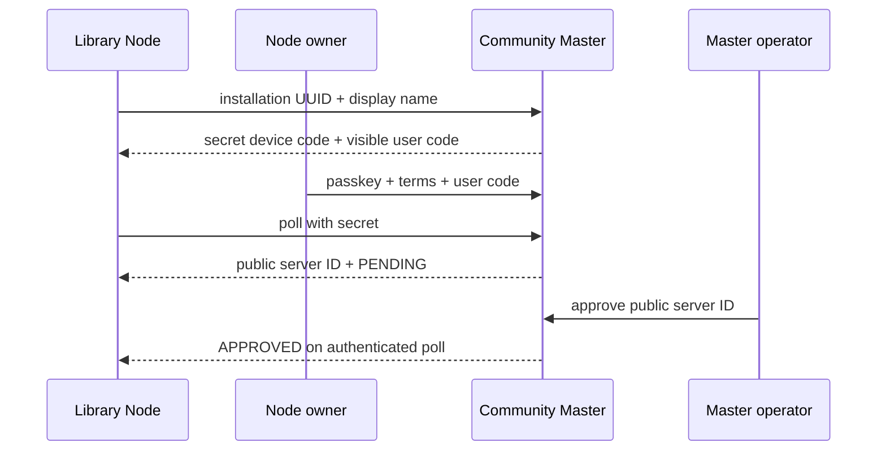
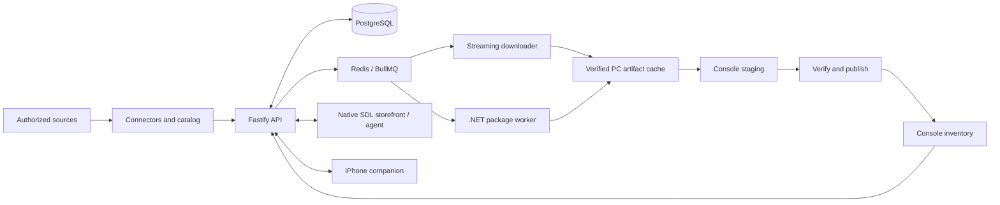

# Architecture

## Console-local presentation assets

For the registered PS5 itself, installed/dump artwork and menu music stay on console storage. Device status supplies exact inventory/storage paths only to that authenticated device session; the frontend resolves fixed `sce_sys`/`appmeta` filenames beneath those roots and decodes them asynchronously. No console-artwork upload endpoint exists. The server artwork/music service remains the fallback for remote catalog entries, iPhone and other consoles.

## Product boundary

PS5Library replaces the store experience for authorized content: its own native home entry, controller-first catalog, accounts, preparation, downloads, notifications, installation, inventory and launching. It uses PS5Library branding and a separately paired PS5Library server; it does not require, proxy or imitate a Sony account or PSN service.

System UI integration is capability-based. The app uses verified native home, notification, download and launch APIs where a firmware/runtime supports them, and keeps the same PS5Library flow inside the app where it does not. A successful call is not advertised until physical behavior is confirmed on that runtime.

## Approved two-part topology

PS5Library has two independent security and distribution domains.

| Domain | Source distribution | Holds game content | Responsibility |
| --- | --- | --- | --- |
| **Library Node** | Public/releasable self-hosted code | Yes, only content configured by that operator | Accounts, consoles, explicit family/friend grants, catalog, builders, verified artifacts, native installation delivery, private backups and console state |
| **Community Master** | Private backend implementation; public versioned client contract | Never | Global opt-in identity, friendships, groups, end-to-end encrypted chat, save-publication index/storage, moderation, presence and game-session matchmaking/signaling |

The public-release guard rejects tracked `master/`, Master Docker files, `.env`, signing material and runtime data. Public server Docker builds exclude the private Master implementation from their build context. The shared public contract contains data schemas and capability names, not Master deployment code or secrets.

An optional private network uses an existing audited WireGuard deployment. PS5Library will not invent a VPN or cryptographic transport. The Master may coordinate device public keys and reachability after explicit approval, but game/package bytes travel directly between an authorized Library Node and its authorized client. The Master is never a game-content relay.

### Private-library authorization

- Every user, console, session and job remains owner-scoped.
- Friendship or Master group membership never grants access to a Library Node.
- A Library Node owner explicitly invites an account and explicitly grants either selected games or the existing all-members catalog option.
- Migration `027_game_shares.sql` adds per-user game grants. Catalog, sources, compatibility profiles, artifacts and installation planning now use the same `game_read_access` policy.
- Revoking a grant prevents new reads and installations. It does not silently delete a title already installed on a friend's console; removal is a separate owner/user action.
- The Master cannot mint Library Node administrator, device or download credentials.

### Community Master enrollment

Each Library Node has one persistent installation UUID. On first opt-in it requests a ten-minute device authorization, shows the owner a short code and exact HTTPS link, and stores the returned 256-bit device secret encrypted with its local bootstrap secret. The owner signs in to Master with a passkey, accepts the exact terms version/hash and authorizes that code. Master then creates a stable public `srv_...` identifier in `PENDING` state.

The public identifier names the Node in account and operator views; it never authenticates a request. Only the separate secret credential does. A different `MASTER_ADMIN_TOKEN` protects the private operator console, where the Master owner approves, bans or unbans the identifier. State and reasons synchronize to the Library Node web manager and iPhone companion. PostgreSQL retains the request and operator audit trail; logs redact credentials.

### Direct native FPKG installation

The package is built and retained on the Library Node. Installation still requires the PS5 to receive the bytes; a server cannot install bytes that never reach the console. The intended path avoids a second complete staging copy:

1. The Library Node builds or reuses an exact verified FPKG.
2. It creates a random, hashed, expiring capability restricted to one console, job and artifact.
3. The authenticated agent submits that URL to the verified native package installer.
4. The PS5 system service pulls the package directly with HTTP Range support while the Library Node records actual covered bytes.
5. The agent reports installer state and fresh inventory. `READY_ON_PS5` requires the expected title/version to appear.

If a firmware/runtime cannot perform verified URL-based native installation, this method is reported unavailable. PS5Library does not disguise a copy-then-install fallback as native installation.

### Portable save flow

Decrypted save cryptographic material stays on consoles. A raw safety backup retains only the console-sealed key material already required by its encrypted image; the Library Node and Master never receive an unsealed save key.

The private safety path copies the original encrypted PS4/PS5 image and required sealed metadata into `RAW_CONSOLE_V1`, hashes every member, rejects changing inputs and resumes upload to an owner-scoped Library Node record. PostgreSQL stores the exact console/local-user/title/slot identity and real uploaded bytes; only a fully verified archive is available for authenticated Range download. It remains console-bound.

The portable path is now implemented behind separate `saveExport`, `saveImport` and `saveRollback` capabilities:

1. The source console must report the exact installed title/version and an existing save slot. The agent refuses export while that title is running.
2. The agent briefly elevates only for key/mount work, restores its credential, then exports bounded files while unprivileged. `sce_sys`, links, keys and unsafe paths are excluded.
3. The Library Node resumes, validates and privately stores the immutable `PORTABLE_FILES` archive. Local export/download/import do not require Master consent.
4. Community publication is a second explicit opt-in gated by the current terms. Master keeps the upload quarantined until an independent operator marks the immutable record `CLEAN`.
5. Discovery and delivery require the exact platform, game/save Title IDs and game version. The receiving Node rejects any mismatch between the requested identity, catalog item, manifest, URL, size or hash.
6. Import requires a pre-existing target slot and a fresh server-side raw backup. The agent refuses the active target game, verifies the archive, takes an additional local encrypted-image rollback copy, imports through a local mount and restores on failure.
7. Unsealed save keys never leave either console. The result remains untested until the matching game loads it.

The physical 4.50 test completed this full round trip for one PS4 slot and reproduced the source portable bytes after import. PS5 import, other firmware/runtime combinations and in-game acceptance remain unknown. Generic title files may contain account-specific data that no cross-game parser can identify; the manifest states that embedded identifiers were not generically removed.

### Community services

- **Identity:** passkeys plus recovery codes; one-use device authorization for each local user/PS5Library client; short-lived access tokens and rotating refresh tokens. The Library Node encrypts each user's Master session separately and never exposes or substitutes the server-wide Node credential.
- **Friends/groups:** explicit requests, blocks, privacy settings, membership roles and audit events.
- **Chat:** end-to-end encryption using an audited implementation. The Master stores ciphertext, delivery metadata and abuse reports; it does not receive plaintext message keys.
- **Presence:** coarse opt-in availability with short retention. Exact IP, console inventory and private-library activity are not social-profile fields.
- **Game sessions:** the Master provides lobby/matchmaking and authenticated signaling for homebrew or individually implemented title adapters. Actual game traffic is peer-to-peer or uses a dedicated relay. A generic PSN redirect is not a supported architecture.
- **Moderation:** rate limits, blocks, report queues, immutable evidence references, retention limits and operator separation.

### Native PS5 surfaces

The app and companion expose the complete feature set. Verified native system integrations may add notifications, package-download progress, title launching and inventory. ShellCore/Game Base integration is a separate firmware-specific adapter with exact module hashes, original-byte checks, a disable switch and recovery path. Until an adapter is physically verified, friends, chat, trophies, saves and progress remain inside PS5Library's native application rather than claiming control of Sony system surfaces.

PS5Library does not request PSN passwords, impersonate Sony endpoints, bypass TLS trust, forge Sony tickets or advertise itself as an official service. Native game networking is added only for homebrew or a title-specific integration the operator is authorized to run.

## Current deployment/rendering, 2026-09-16

The Docker deployment separates the Node API from a bounded, unprivileged, networkless worker containing the .NET package tools, FFmpeg and Sharp. The worker sees sources, dumps and published data read-only and can write only job, trailer and artwork staging. PostgreSQL/Redis volumes persist. Portable relative paths and the one-time source-key migration preserve identities across Windows/Linux. The container smoke check exercises isolated artwork/video processing, authenticated Range delivery and restart persistence.

SDL caches unchanged composed heroes. Rounded controls use rectangle-body blits and triangles only at corners. Telemetry separates drawing, presentation and full frame intervals; PS5's blocking flip needs no additional frame sleep. Network/decoding remain on background threads. Native and web libraries distinguish server artifacts from console inventory. Local ShadowMount API negotiation separates a running process from a usable installation method.

## Expanded native-network target

PS5Library is also the account/setup gateway for the optional Community Master. The target includes profiles, friends, messages, groups and game-session coordination; game networking requires separate verified compatibility. Account/pairing APIs are implemented, but a ShellCore/Game Base protocol adapter is not. See [native network research](NATIVE_NETWORK.md) for the evidence, required contracts and first reversible experiment.

The first profile data slice reads actual local trophy aggregates through the agent and presents them privately on the server. This does not redirect native Sony services. See [trophy collection](TROPHIES.md) and [signed app updates](UPDATES.md).

The private [Community Master](COMMUNITY_MASTER.md) is a separate, optional service. Library Nodes keep all games, packages, sources, console credentials and installation work. The Master accepts only individually opted-in portable save publications and community/session data; it has no game-download API. Community connection is off by default, and each save revision also requires explicit publication.

## Working structure

The API is the only client-facing service. PostgreSQL owns users, source records, releases, consoles, credentials, capabilities, storage, downloads/builds/transfers, installation requests, job events, compatibility/backport records and artwork pointers. Redis schedules work; it is not the sole record of completion. Workers reconcile durable jobs after restart.

`Game` groups base/update/DLC releases. Server bookmarks and cached packages are separate from `ConsoleLibraryEntry`. A transfer is not ready until the authenticated console reports matching physical inventory and, where required, registration.

## How the server talks to a PS5

1. The PS5 initiates an HTTPS connection to the configured PS5Library server. It requests a short-lived pairing code; the signed-in owner claims that code from the companion. The console keeps its random device credential, bound to that server, across launches.
2. The agent measures firmware once at registration and persists it locally and on the server. `/api/v1/device/heartbeat` carries the saved value alongside current runtime information, capabilities, storage and managed inventory; ordinary heartbeats cannot replace saved firmware. Owner-requested refresh uses a durable single-use challenge. Unknown runtime information stays unknown. The server derives presence from recent authenticated activity.
3. The PS5 storefront or iPhone submits an installation request. The PC downloads, checks and prepares the selected release, or reuses its matching verified cache. PostgreSQL preserves the request across restarts.
4. The PS5 asks `/api/v1/device/tasks` for its own queued transfers and pulls the supplied authenticated artifact URL. Range requests resume `.part` files. The server does not need an incoming connection to the PS5 or an exposed console loader port.
5. The agent reports measured bytes to `/api/v1/device/tasks/:id/progress`. It checks size/hash, publishes the completed file outside staging, and requests the supported runtime's registration. The server requires matching console inventory before READY.
6. Both clients read the resulting server state. Removing a managed file changes it to MISSING. Deleting a cached PC build leaves the console copy and source intact.

The PC must remain running for preparation and delivery. An offline PS5 can have content prepared for later, but cannot receive it until its agent reconnects. The current foreground app runs an agent thread; a separate agent ELF is also built. Background operation while playing, suspension and reboot autostart are not verified. Closing the iPhone never owns or cancels server work.

For friends outside the home network, publish the server through configured HTTPS or a private VPN. Each friend signs in separately and pairs their own PS5. Do not expose the PS5's unauthenticated homebrew loader as the PS5Library connection method.

### Offline storefront mode

The native Settings toggle persists an explicit offline marker. While enabled, the storefront does not refresh, pair, update or submit authenticated Library Node requests. The separate payload agent continues local inventory/runtime/storage discovery and serves its bounded snapshot plus console-local artwork/music over authenticated TCP bound to the console's exact private IPv4 address. The listener rejects peers other than the console itself; the title mount supplies only a held lifecycle lock. A cached or locally discovered title that the current inventory marks launchable can still offer **Play Now** through the local console launcher.

Preparation, downloads, transfers, installs, firmware refresh, save export/import and account changes require the Library Node and are disabled. Exact-title launch plus capability-gated local move/delete use the same agent endpoint. Re-enabling the toggle starts a fresh authenticated server refresh. Firmware 4.51 hardware proves the installed storefront-agent exchange, exact same-console peer rejection, a complete 21-title response, kstuff runtime state and ShadowMountPlus 1.7beta2 detection. A PS5 without any active private-network interface cannot use this channel; no mutable-file fallback is enabled.

## Ownership

Catalog reads use `game_read_access`: owned games, explicitly shared titles and titles observed on the owner's console. Sources, jobs, consoles, credentials and profile data stay owner-scoped. An admin can invite friends and share/unshare owned games; admin status does not bypass another owner's private data. Friends can pair multiple consoles. HTTP user and device endpoints accept distinct credential types.

Watched games default to shared within this private server. A source-owner root resolves shared local content, preventing a friend's account ID from changing the source path. Cached packages/artwork/trailers may be read through shared-game authorization; deletion and source administration remain with the owner. Unsharing persists across scans.

## Preparation and installation

`POST /api/v1/installations/plan` takes a source release and registered console. It computes supported methods, compatibility and storage estimates before building. `POST /installations` records the user's selection. A database coordinator obtains/reuses a verified artifact, waits for the console if offline, recalculates storage against the actual output, then queues the transfer. Repeated confirmation and coordinator restart cannot create duplicate transfers for the same active request.

Folder/ZIP preparation uses real FPKG or UFS builders. Other recognized ready artifacts can be downloaded/verified directly. Unsupported extraction/conversion stops explicitly. Cache keys contain the source hash, builder revision, installation method and pipeline version. Deleting a PC cache copy does not delete the source or the console's copy. Active transfers protect their artifacts against deletion.

Compatibility uses exact Title ID, Content ID, version, hashes, target firmware, runtime and method. Firmware eligibility alone does not mean launch-tested. Version 0.2.7 verifies the exact profile's supplied files before preparation. FPKG variants embed selected libraries and have their own profile digest/cache identity. ShadowMountPlus 1.7 overlays use separate verified staging and atomic publication. Missing files block preparation; untested matching profiles remain labelled and warned. Required patch hashes validate supplied input/output files; optional saved BPS/SDK recipes apply in private staging. An admin can generate an exact `UNTESTED` SDK/fake-sign recipe for target families 1.x-10.x from an owned prepared folder; game-specific library/import fixes and physical launch verification remain outstanding.

Native base-FPKG delivery uses AppInstUtil with a per-job capability URL derived from the connected server origin. PostgreSQL persists URL grants and actual HTTP range coverage. Native request acceptance is not installation completion: exact installed package bytes, metadata and inventory must agree. The first adapter confirms internal base installs only; native hardware behavior, updates/DLC and external destinations remain unverified or unsupported. It does not use native status calls associated with upstream process crashes, or route filesystem images through the package installer.

The watch pipeline persists stability observations and automatic preparation/import ledgers. Root compatibility libraries are separated before either builder runs and stored as unclassified exact-release backport records. Game-only artifacts are shared; the transfer planner recomputes compatibility for the chosen console and attaches no backport when its firmware meets the requirement. [WATCH_FOLDER](WATCH_FOLDER.md) specifies paths, cache/deletion behavior and limits.

Trailers use persistent server transcoding and authenticated Range delivery. The native frontend downloads/decodes in background workers and starts playback after five seconds highlighting the same cover. [TRAILERS](TRAILERS.md) distinguishes host checks from pending PS5 playback validation.

## Frontend

Version 0.2.8 follows the user's Desktop `storefront.png`: single-row navigation, a cinematic hero fading into two cover rails, translucent pills and restrained blue-white focus. Inter 4.1 regular/semibold are bundled with their SIL OFL notice; controller and utility symbols are drawn as geometry so font coverage cannot hide them. Title wrapping uses the same cached text as rendering. Width measurements share the existing expiring text cache. Rounded fills align body/corner boundaries to the output pixel grid without rasterizing whole cover cards as triangles.

`ps5/tests/storefront.py` drives the actual host app through search results, View All, Game Details/back and top-row utilities at console resolutions. Collection membership is kept in the existing screen state and cleared when switching sections; no new server endpoint or catalog fixture is needed in production.

The actual PS5 UI is C++17 + SDL2/SDL_image/SDL_ttf + libcurl + json-c. `frontend/design.hpp` owns layout tokens; `focus.hpp` owns controller navigation; `render.hpp` owns drawing/text caching; `artwork.hpp` owns two background image workers, conditional HTTP cache, decode cancellation and bounded GPU texture uploads. `main.cpp` composes the storefront screens from these primitives. Layout uses a logical 1920×1080 canvas scaled by SDL.

Production data is authenticated API data. `--preview` explicitly loads local design fixtures and refuses mutations. Network/decoding runs outside the render thread. A missing artwork texture draws a branded fallback. No commercial catalog is hard-coded into the production app.

First launch opens a controller-operated server connection dialog. SDL text input uses the PS5 port's existing native keyboard. The app embeds its initial font/CA assets, validates the server origin and saves the connection through the same process lock as the agent. Switching an already paired server requires a new pairing, cancels network/hash work, drains background workers and restarts the connection without rebuilding the window. The modal uses a state indicator while saving; it does not invent a progress percentage. Server/console-bound receipts prevent the new connection from reporting the previous pairing's library.

The server exposes durable job events with a resumable cursor. Browser and iPhone clients merge authenticated WebSocket events into their current job models; terminal or unknown jobs trigger one authoritative snapshot reconciliation. The host/legacy PS5 event path can merge REST cursor events, but that worker remains disabled in the production native build after the storefront crash quarantine. Native PS5 therefore receives the same progress fields through its retained five-second authenticated snapshot until the event path is hardware-safe. Push changes for storage/inventory are outstanding. The iPhone closes independently of server jobs.

### Local rendering measurements

Latest, 0.2.8 (2026-09-16): 240 Discover frames with the local reference fixture on the Docker/Linux SDL dummy software renderer measured **6.265 ms median / 9.166 ms p95**, with 14,587,808 bytes of artwork textures. Repeated font-width measurement was a regression in the initial Inter pass (about 21 ms median); sharing the existing text cache fixed it. The screenshots are actual widgets rendered with explicit offline fixtures. Hardware timing for this build remains unmeasured.

On 2026-09-15, the Docker/Linux SDL dummy **software** renderer was exercised with the local reference fixture for 150 frames at 1920×1080. The Downloads screen initially measured a median 83.882 ms and p95 86.100 ms after rounded-shape scaling was corrected. Drawing only the glow border, instead of repainting the full card for each glow layer, reduced the same check to **29.616 ms median / 31.418 ms p95**, with 14,587,808 bytes of loaded artwork textures. Timing includes rendering/presentation; the preview's artificial inter-frame wait is excluded.

These are local comparison runs, not PS5 GPU measurements or a 60 FPS claim. Discover was also visually checked at 1280×720. Reproduce the Downloads check with the README's preview command plus `--screen=Downloads --frames=150`; the executable prints timings and writes `performance.json` beside its configuration. Hardware frame time, game coexistence and large-library stress checks remain required.

## Known ceilings

Global short locks serialize cache publication/quota and the installation coordinator. This is adequate for a small private server; partition by volume/account when throughput demands it. API catalog pagination, full large-library virtualization, large-archive streaming conversion, storage moves and physical verification/recovery of automatic backport delivery remain required before calling this production-ready. See [STATUS.md](STATUS.md).
