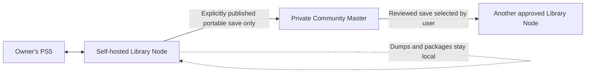
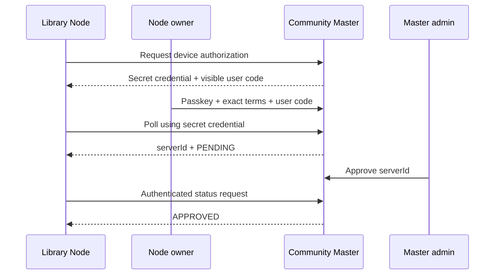

# Community Master

## Status

**IDENTITY, NODE APPROVAL, PRIVATE ADMIN CONTROL, NATIVE APP UPDATES, SOCIAL FOUNDATION, GAME-SESSION RENDEZVOUS AND SAVE QUARANTINE IMPLEMENTED / DEPLOYED.** The private Master has passkey accounts, Node-bound rotating sessions, one-use recovery, Library Node enrollment, operator approval/ban/unban, a passkey-protected installable admin PWA, approved-console app-update activation, friends/blocks/privacy, coarse expiring presence, opt-in game-session coordination, versioned terms, save staging/withdrawal, and reviewed immutable save discovery with HTTP Range delivery. The initial operator still has to enroll a passkey and bind its account UUID before authenticated production administration begins.

The public Library Node persists one stable installation identity, encrypts its separate Master credential with the local bootstrap secret, and reports `AWAITING_OWNER`, `PENDING`, `APPROVED`, `BANNED` or disconnected state in its administrator web UI and iPhone companion. Each local user can separately link a Master account with a one-use device code; friends, presence and game-session calls then remain scoped to that local user and their paired storefront credential. Portable export/import, owner-scoped Community discovery/download and rollback-first delivery are implemented. The private operator UI can publish or reject quarantined saves; automated quarantine scanning, MLS clients and actual title-network adapters remain pending. Raw console-bound backups cannot be published.

## Planned direct-console testing and release

**NOT IMPLEMENTED:** multiplayer clients will be able to use Community Master without installing a Library Node. The Node remains optional for private game libraries, packages, saves and local administration; it will not be required for identity, title-adapter delivery or multiplayer.

- An empty Master deployment is claimed with a one-use bootstrap secret chosen by its operator. Possession of the first network connection alone is never sufficient.
- The bootstrap browser flow creates the operator's passkey account, binds it as the Master administrator and approves that operator's first console in one transaction. The stored bootstrap capability is then consumed permanently. A restart cannot reopen first-owner enrollment.
- During private testing, later consoles remain pending until that same administrator approves them in Master Control. There is no unrestricted auto-approval mode.
- A console links directly with a short-lived device code. After browser approval, the agent receives a console-bound rotating credential and communicates with Master without a Library Node proxy.
- The user chooses a multiplayer display name during linking or account settings. The agent submits the requested name, Master validates and stores the accepted value, and title adapters read that stored identity. A game request cannot supply a different per-request name or impersonate another account.
- The RoadCraft adapter will place the Master-approved display name in the player/session records returned to RoadCraft, so every peer sees the same name. Its exact character and byte limits remain blocked on the decoded RoadCraft field constraints.
- Before public release, direct-console enrollment, credential recovery/revocation, signed adapter delivery and two-console RoadCraft behavior must pass hardware testing.
- After those gates pass, release the Master, agent, title-adapter, public schemas and deployment manifests together. Release packages exclude credentials, runtime databases, logs, private user data and copyrighted game executables. Each self-hosted deployment retains the same one-use owner-bootstrap flow.

## Source and service boundary

- During private validation, the Library Node, Master, PS5 app/agent, title adapters and versioned Community schemas remain in the development workspace.
- The release target includes the Master implementation, migrations, deployment manifests, agent and reviewed title adapters after their test gates pass.
- Release guards must reject runtime data, environment files, credentials, signing keys, logs, private user data and copyrighted game files while allowing the reviewed source and empty deployment templates.
- Private source is not a security control. Every request still authenticates, validates input and enforces ownership.
- The Master never receives or serves dumps, PKGs, FPKGs, backports, private source URLs, repository credentials, console credentials, PSN credentials or unsealed save keys. It cannot start a game download or installation.

### Current companion and proxy boundary

- The regular iPhone companion accepts only a Library Node. Before sending a password or saved bearer credential it requires the unauthenticated `GET /api/v1/service-info` response `{ "service": "ps5library-node", "apiVersion": 1 }`; a Master or unrelated service is rejected.
- Community application calls always terminate at the selected Library Node. The Node authenticates the local user, loads its separately sealed approved-Node credential and proxies the bounded request to the Master.
- Proxied user calls carry the Node credential in `Authorization` and the short-lived Master user credential in `X-PS5Library-User-Token`. The Master validates both, requires the user session to belong to that exact approved Node, and rejects a pending, banned, revoked or different Node on its next request. A Node-bound user credential cannot be replayed directly or through another approved Node. The companion receives neither Master credential.
- The only direct iPhone-to-Master interaction is an explicit OS-browser navigation to the exact Master-origin WebAuthn device-authorization page returned through the Node. No companion API request, Library Node password or local bearer credential is sent there.
- The Node does not return its configured Master origin in normal status models. It returns only the single-use browser authorization URL while a link is awaiting approval.

### Master/Node communication security

**VERIFIED:** stored credentials are accepted only for the Node's configured exact Master origin; redirects and response-provided foreign origins fail closed. Sealed Node, device-flow and per-user session values use separate AES-GCM domains tied to that origin and, for user sessions, the local user UUID. Master sessions, game-session membership and private rendezvous data are bound to the exact approved Node. Disconnect revokes Node/user sessions, pending authorizations, update grants and rendezvous access atomically; credential replacement always requires fresh operator approval. Unknown Master error strings are not reflected through the Node.

The Library Node and Community Master must use different HTTPS origins. Configure the public Node host separately from `PS5LIBRARY_MASTER_HTTPS_HOST`; do not route both applications under different paths on one hostname. The proxy configuration is ready, but production cutover remains pending creation of the dedicated Master DNS record and verification. Legacy Community ciphertexts without a purpose domain fail closed and must be relinked.

**REMAINING:** native app-update activation is short-lived and IP/grant bound rather than cryptographically bound to one console for every file request. The long-lived Node bearer remains immediately revocable and digest-only on Master, but automated expiry, credential rotation and last-use telemetry are not implemented.

## Identity and Node approval

- Global accounts use discoverable WebAuthn passkeys with required user verification. The Master stores a public key and counter, never a passkey private key.
- Access credentials expire after 15 minutes. Refresh credentials rotate, have a seven-day idle limit and a 30-day absolute family limit. Reusing an old refresh credential revokes its family.
- Ten 128-bit recovery codes are shown once and stored only as SHA-256 digests. Each is single use. The last passkey cannot be removed.
- A Node receives a public random `srv_...` identifier and a separate 256-bit secret credential. The identifier is display/search data only and is never accepted as authentication.
- First connection uses a limited-input device flow. The Node receives a short-lived user code; its owner opens the exact HTTPS `/connect` page, signs in with a passkey, reviews the exact terms version/hash and authorizes the Node. The Node still remains `PENDING`.
- The separate `/admin` controller is an installable responsive PWA for the one account configured by `MASTER_ADMIN_ACCOUNT_ID`. Opening an admin session requires a passkey-authenticated Master session created within the preceding five minutes; recovery-code and Node/device sessions cannot elevate. The regular companion has no Master-admin privilege.
- Admin state uses a short-lived `HttpOnly`, `Secure`, `SameSite=Strict` cookie. Mutations additionally require the exact configured origin and a matching CSRF token; approval, ban/unban and save-review actions require an admin session created within the preceding ten minutes. Sign-in, sign-out and operator actions are auditable.
- `MASTER_ADMIN_TOKEN` is emergency recovery only. It is accepted only when the TCP peer is loopback; `X-Forwarded-For` cannot make a remote request local. It is never entered into `/admin`, retained in browser storage or accepted through the public reverse proxy.
- A ban takes effect on the Node's next Master request. Unban restores the existing credential. Disconnect revokes the Node and begins withdrawal of active publications.
- A local user's social link uses a separate ten-minute device code and produces a short-lived access/rotating refresh session bound to the authorizing Node. The Node encrypts the session at rest, binds its sealed contents to the local user UUID and serializes refresh rotation. It never reuses the server-wide Node credential for user social data. The binding migration revokes legacy sessions that cannot be classified safely.

### Operator setup

- Set `MASTER_PUBLIC_URL` to the exact public HTTPS origin and `MASTER_DATABASE_URL` to the private PostgreSQL database.
- Set `MASTER_ADMIN_ACCOUNT_ID` to the UUID of the single passkey account allowed to operate Master Control. `MASTER_ADMIN_SESSION_MINUTES` controls its fixed short session lifetime.
- Generate an emergency recovery token with `node -e "console.log(require('node:crypto').randomBytes(32).toString('hex'))"`, place it only in `MASTER_ADMIN_TOKEN`, and protect the environment file as a secret. It is usable only by a process connected directly through loopback.
- Build the ignored private image with `docker build -f docker/master.Dockerfile -t ps5library-community-master:local .` and run it behind the HTTPS origin. The container runs as the unprivileged `node` user.
- Sign in to the configured Master account with its passkey, then open `/admin`. The responsive PWA can be added to the administrator's phone home screen and controls Node approval/ban/unban, save review, health summaries and audit history through the same protected origin.
- Fastify writes redacted structured logs to stdout according to `MASTER_LOG_LEVEL`. Durable authentication, `SERVER_REQUESTED`, `SERVER_APPROVED`, `SERVER_BANNED`, `SERVER_UNBANNED` and save-review records appear in the operator audit view.
- `MASTER_GAME_SESSION_ADAPTERS` is a comma-separated allowlist of adapter IDs. It defaults empty, so no game session can be hosted until an operator explicitly enables a reviewed adapter.
- On each self-hosted Node, set only `COMMUNITY_MASTER_URL` to that exact HTTPS origin. The Node owner requests access from Server manager or the iPhone companion.

### Native PS5Library updates

- A paired console asks its approved Library Node for a one-use ten-minute activation token. The Node sends only an HMAC-derived console reference, display name and saved firmware; its local console UUID and device credential are not disclosed.
- The PS5 redeems that token directly with the Master. Home receives an update only from `/from/<installed-content-version>/version.xml`, when the requesting IP has a current activation and the owning Node remains approved.
- The unbound feed is deliberately empty. A wrong base version is also empty, preventing chained patches from being offered to the wrong installed version.
- Manifest, delta, PlayGo and package URLs carry a random short-lived grant bound to the activated console IP. The Master release directory contains only the PS5Library application patch artifacts.

### Native game-download path

- Game packages and their download URLs remain on the owner's Library Node. The Community Master is not in this path and has no game-content endpoint.
- The Library Node persists the owner-scoped installation job and issues a revocable, job-scoped HTTP Range URL. The PS5 agent submits that URL through `sceAppInstUtilInstallByPackage`; after acceptance, the native PS5 Downloads service owns the pull while the Node measures unique bytes served for durable progress.
- Submission intent is persisted before the native call. A restart after an accepted submission resumes monitoring without submitting twice; an ambiguous `SUBMITTING` marker fails as `NATIVE_SUBMISSION_UNCERTAIN`; a synchronous native rejection clears the marker so an explicit retry can submit again.
- **VERIFIED OFF CONSOLE:** request authorization, Range accounting, restart state and native-boundary host tests pass. **PS5 HARDWARE E2E UNKNOWN:** native Downloads presentation, complete installation, inventory confirmation, ready notification, update/DLC completion and external-storage behavior still require a real-console run.

## Consent

- Community connection defaults to **OFF**.
- Node authorization requires an explicit owner action and exact terms version/hash acceptance.
- Every save remains **PRIVATE** by default. Enabling Community never publishes an existing or future backup.
- Publishing one revision, downloading one revision and restoring it are separate confirmations.
- Disconnecting revokes the Node credential and changes its active publications to withdrawal.
- A terms change blocks discovery and delivery until the new exact version/hash is accepted.

The bundled text warns that community saves can corrupt or destroy progress, requires a separate backup, supplies saves as-is and limits liability only to the maximum extent permitted by law. Production operators still need jurisdiction-specific legal review.

## Save publication identity

A publication matches exact structured fields, never a game name alone:

- platform
- game Title ID
- save Title ID
- exact game version
- region where present
- portable archive format version
- archive SHA-256 and size
- publisher display name, description and timestamp

The strict public manifest excludes local paths, account identifiers, PSN credentials, console credentials, encryption keys and repository information from its structured fields. The portable archive also excludes platform metadata and `sce_sys`. Generic code cannot prove that a game's own files contain no account-specific values, so the manifest truthfully records `embeddedAccountIdentifiersRemoved: false`; publication remains an explicit owner choice. Compatibility is limited to the exported game version.

An approved Node may create a publication record and stream the declared archive to a unique quarantine path. The Master enforces the strict manifest, exact byte count and SHA-256, syncs the file and records receipt. It remains `PUBLISHING` and invisible because `scan_result` and `reviewed_at` are unset. Withdrawal removes an unreviewed quarantine object. No publisher endpoint can mark its own upload clean.

Only an operator-reviewed `CLEAN` immutable record is discoverable. `GET /api/v1/saves?gameTitleId=...` groups results by exact game version; optional `gameVersion` narrows it. Authenticated full and Range delivery revalidates file type, link status, generation, size and SHA-256 before serving the verified open handle.

The receiving Node downloads into isolated staging, enforces archive limits, verifies the exact catalog/manifest/hash and creates a raw rollback backup before an explicit import. The target must already report the exact slot and game version. Export/import occurs on consoles, and unsealed save keys never enter either server. One PS4 round trip passed on firmware 4.50; PS5 import and in-game acceptance remain unverified.

## Ownership and social boundary

Only the publishing account can withdraw its record. Operator quarantine cannot make a private save public. Account deletion will revoke sessions, withdraw publications and retain only the minimum moderation audit record; that deletion flow remains pending.

Exact-handle friend requests, accept/decline/cancel, unfriend, block/unblock and `EVERYONE`/`NOBODY` request privacy are implemented. Blocking atomically removes friendship and cancels pending requests in both directions. The Library Node proxies the friend/request/presence subset through the authenticated local user's encrypted Master session; the paired PS5 frontend receives only that owner's friend presence. A Master relationship never grants Library Node, console, game or package access.

The paired storefront also converts its own account transition into one owner-scoped local console notice: a polished welcome after connection or a bounded reason after failure. The Master does not address the PS5 directly. The owning Library Node persists the notice, and only the separately paired console agent can consume and acknowledge it.

Group/chat storage is deliberately absent. RFC 9420 MLS must run on clients; the Master may later retain only bounded opaque delivery envelopes and membership metadata. A plaintext or custom-crypto placeholder would violate the architecture.

Presence is coarse, opt-in and friend-scoped. An authenticated heartbeat publishes only `ONLINE` or `AWAY`, expires after 90 seconds and reads as `OFFLINE` after expiry; blocking removes visibility with the friendship. Game sessions will support only homebrew or individually authorized title adapters. They will not impersonate PSN, forge tickets, accept PSN credentials or make arbitrary titles work through DNS redirection.

The first game-session layer is a bounded rendezvous service. An enabled adapter can create a 90-second session for an exact Title ID and game version, refresh it while hosting, and close it. Current friends can discover that exact match; the public result omits opaque connection data, which is returned only after a capacity-locked join. Friend presence carries only a public session summary, which the PS5 Profile and iPhone Friends views render as `Playing online` with current/capacity. The Master does not interpret or connect to private adapter data. No packet relay, NAT traversal, voice, generic multiplayer compatibility or native Game Base integration is claimed.

## Delivery order

1. Local immutable raw save backup/upload/download. **Implemented and physically verified for one PS4 slot on firmware 4.50.**
2. Rollback-first portable export/import with firmware-specific mount support. **Implemented; one PS4 byte-exact round trip passed, PS5 remains unverified.**
3. Passkey identity, Node-bound device authorization/sessions, approval/ban, recovery and revocation. **Implemented, tested and deployed; initial operator enrollment remains.**
4. Private Master Control PWA for the configured passkey administrator, including Node and save moderation plus audit history. **Implemented, tested and deployed; operator binding and phone-device validation remain.**
5. Per-save portable publication/withdrawal. **Implemented to quarantine with manual operator publish/reject; automated scanning remains pending.**
6. Reviewed discovery/delivery plus local verification and explicit import. **Implemented; game-level compatibility is never inferred from metadata alone.**
7. Friends, blocks and privacy. **Master implemented; scoped Library Node bridge and PS5/iPhone friend UI implemented in source, hardware/Xcode verification pending.**
8. End-to-end encrypted groups/chat. **Pending client MLS implementation.**
9. Coarse friend presence. **Master API, scoped Node bridge and PS5/iPhone presentation implemented in source; hardware verification pending.**
10. Friend-only game-session rendezvous. **Master API, owner-scoped Library Node/device bridge and PS5/iPhone friend-activity presentation are implemented in source; disabled until a reviewed adapter is configured. Title adapters, packet transport and hardware presentation remain pending.**
11. Native Swift Master Control companion. **Pending. Build it as a separate private iOS target with its own bundle identity and release workflow. It must use passkey authentication, short Master-admin sessions and the existing CSRF-protected admin API; no Master origin, credential or administration code may enter the regular companion or public release. The deployed PWA remains the controller until this native app passes Xcode, device and security validation.**

No game-content endpoint belongs in the Community Master.
