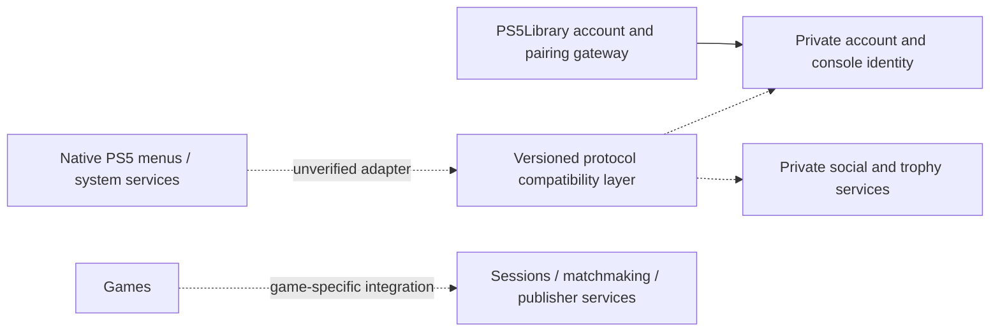

# Native PS5 private-network research

## Product target

The user explicitly expanded the goal beyond the storefront: PS5Library is the account/setup gateway; a private backend should ultimately serve native PS5 profiles, friends, messages, parties and supported game networking. Building a separate chat screen alone would not meet this target.

Account creation, invitations, persistent console pairing, per-owner data isolation, opt-in friend-scoped presence and a disabled-by-default game-session rendezvous API already exist. Native system-service protocol compatibility does not yet exist.

The PS5Library clients now have a separate verified host path: each local user authorizes a Master passkey identity with a one-use device code, the Library Node encrypts that user's rotating session, and the paired storefront renders only that owner's friend presence. This is application UI and a private PS5Library protocol. It is not evidence of native Game Base, party, PSN or ShellUI protocol compatibility.

## VERIFIED

- Sony's [party documentation](https://www.playstation.com/en-us/support/games/ps5-party-voice-chat/) identifies Game Base, Friends and Parties as native console surfaces. This documents user-facing behavior, not their wire protocol.
- [psn-api](https://github.com/achievements-app/psn-api) is a client for existing Sony services: its authentication functions exchange an NPSSO credential for an access code and then access/refresh tokens; subsequent requests use those tokens. It is not a replacement PSN server and does not prove that a native console can authenticate to a private service.
  Inspected commit `1e9d9a806fcd884a4ddee8086bfe92594611da9f`: `src/authenticate/exchangeNpssoForAccessCode.ts`, `exchangeAccessCodeForAuthTokens.ts`, `src/utils/call.ts`, and `src/trophy/user/getUserTrophiesEarnedForTitle.ts`. These are mobile/web service calls; none were executed with user credentials.
- [RPCN](https://github.com/RipleyTom/rpcn), commit `253b3fe79baa35fad11f1ec9d9886837f02b89b4`, `src/server.rs` (`PROTOCOL_VERSION = 33`) and `src/server/client.rs` (`CommandType`, command dispatch): provides its own login, friendship, messages and room protocol for RPCS3. Its README explicitly says real PS3 consoles are unsupported. It demonstrates the need for a matching client implementation; it is not a drop-in PS5 network backend.
- The pinned public PS5 SDK used here does not supply a documented native friends/party server-replacement API. A symbol/stub or string is not a verified function signature, packet definition or safe hook.
- [PS5-PHU-Trophy-System](https://github.com/ArkSama/PS5-PHU-Trophy-System) demonstrates firmware-specific local trophy/NP-related patch research. Its functions do not implement a private friends/chat/party network. PS5Library has read its source and has not applied those patches.
- Local trophy aggregate extraction is a working data path independent of Sony's online service; see [TROPHIES.md](TROPHIES.md). This is not evidence that native profile menus use our backend.
- The private Master now has an application-level session rendezvous for explicitly allowlisted adapters. It binds discovery to an exact Title ID/version and friendship, hides bounded opaque connection data until a capacity-locked join, and expires without a host heartbeat after 90 seconds. This is a backend contract for future homebrew or individually authorized title adapters; it is not a native PS5 protocol, packet relay or claim that an existing commercial title can use it.

## Required research, currently UNKNOWN

| Layer | What must be established |
|---|---|
| Native identity/authentication | Which local services request online state, accepted account identifiers, ticket/token semantics and firmware dependencies |
| Profiles/friends/presence | Request and response schemas, privacy rules, error codes, subscriptions and reconnect behavior |
| Messages | Conversation membership, ordering, persistence, acknowledgments, attachments and live delivery |
| Parties/voice | Session signaling, participant state, transport, codecs, NAT traversal and relay behavior |
| Trophies | Exact per-user/title records, sync semantics and local/native presentation |
| Games | Which platform APIs each game uses and which separate publisher services are required |
| Transport | Endpoint selection, trust checks and any service-specific signing; exact native behavior remains unverified |

A DNS/IP change only changes routing. It does not implement these contracts. Existing public web/mobile API clients are useful references, but are not proof of the PS5 native protocols. Full multiplayer cannot be inferred from working friends or chat.

## First native experiment

1. Map the native read-only profile path on the target console without collecting credentials or message content.
2. Identify one callable, version-checked request boundary with proven arguments and return structures.
3. Implement a local adapter and private backend response for that single read-only function. Use PS5Library identities and separate test accounts.
4. Verify rendering and recovery on 4.51 before expanding to friends/presence. Keep voice and individual games as separate compatibility milestones.

Any later runtime patch must have an exact module/build match, original-byte checks, reversible state, an expiry/disable switch and a tested recovery route. No native hooks, TLS interception, credential redirection or system-file changes have been enabled for this research. PS5Library remains visibly independent infrastructure, not an official Sony service.

## Evidence boundary

Target console: owner-confirmed firmware **4.50**, matching the SDK's current `kernel_get_fw_version()` result. No cross-firmware compatibility is claimed; any firmware-specific work still requires an exact module/build match.
